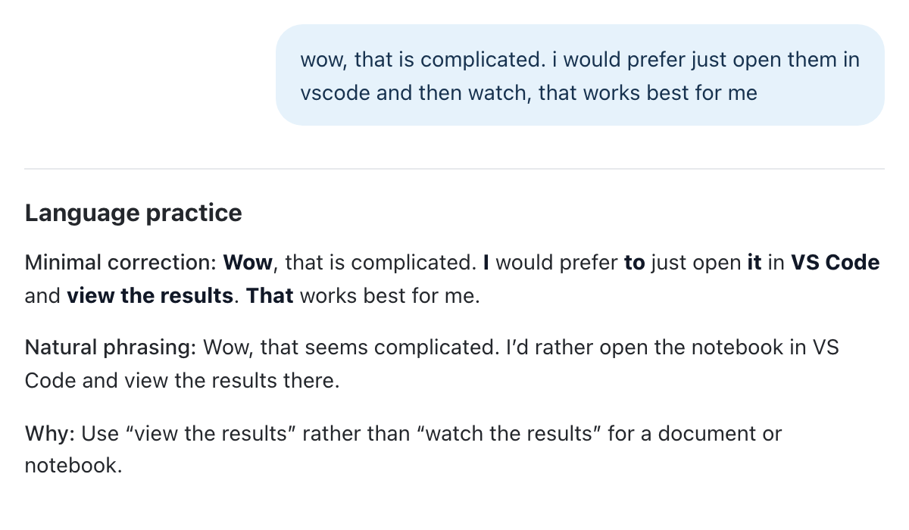
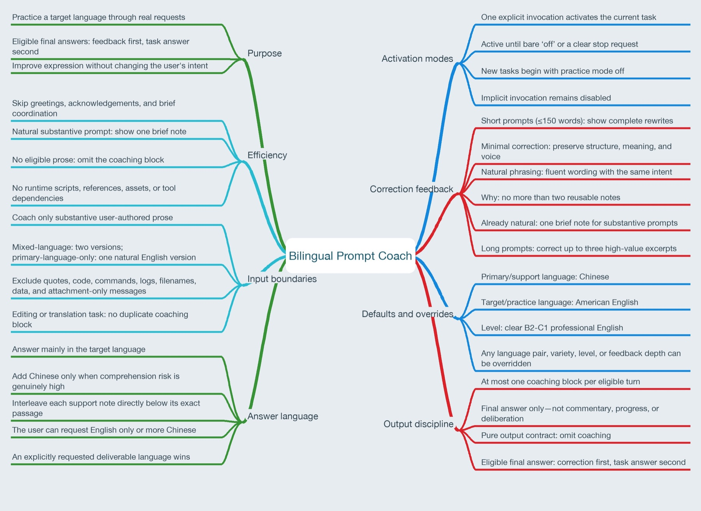

# Bilingual Prompt Coach

[English](README.md) | [简体中文](README.zh-CN.md) | [繁體中文](README.zh-TW.md) | [日本語](README.ja.md) | [한국어](README.ko.md) | [Español mexicano](README.es-MX.md) | [Português (Brasil)](README.pt-BR.md) | [Türkçe](README.tr.md)

Gerçek işlerinizi yaparken dil pratiği yapın. Bu Codex Skill'i açıkça etkinleştirdiğinizde, isteğinizi yerine getirmeden önce kısa dil geri bildirimi sunar ve yalnızca yararlı olduğunda ana dilinizde veya destek dilinizde açıklama ekler.

Varsayılan ayarlar, destek dili olarak Çince ve pratik dili olarak açık, B2–C1 düzeyinde Amerikan İngilizcesidir. Her iki dili, pratik dilinin bölgesel çeşidini ve düzeyini, geri bildirimin ayrıntısını ve iki dilin kullanım oranını seçebilirsiniz.

Yukarıdaki bağlantılar yalnızca belgenin dilini değiştirir. Pratik ayarlarını değiştirmez; dil tercihlerinizi konuşma içinde belirtin.



*Görsel, İngilizce bir yanıt örneğidir. Yalnızca en az değişiklikle yapılan düzeltmedeki değişiklikler kalın gösterilir.*



*Bu şema İngilizcedir ve dil geri bildiriminin hangi durumlarda gösterildiğini açıklar.*

## Genel bakış

Ders çalışma, araştırma, kodlama veya günlük işlerinizle ilgili isteklerinizi her zamanki gibi iletirken başka durumlarda da kullanabileceğiniz kısa dil geri bildirimlerinden öğrenin. Ardından asıl isteğinizin yanıtı gelir.

- İngilizce veya başka bir pratik dilindeki metinler için, yararlı olduğunda en az değişiklikle bir düzeltme ve doğal bir ifade sunulur.
- Tamamı ana dilinizde veya destek dilinizde olan metinler için pratik dilinde tek bir doğal sürüm verilir.
- Birden fazla dil içeren metinler anlamı korunarak pratik diline dönüştürülür.
- Metin zaten açık ve doğalsa gereksiz yeniden yazımlar yerine kısa bir not verilir.
- Zor bölümlerin hemen altına destek dilinde kısa açıklamalar eklenebilir. Sıradan yanıtlar paragraf paragraf tekrar çevrilmez.

## Kurulum

Codex'ten yerleşik yükleyiciyi kullanmasını isteyin:

```text
Use $skill-installer to install the skill from https://github.com/aolongsun/bilingual-prompt-coach.
```

Alternatif olarak depoyu kişisel skills dizininize klonlayın:

```bash
git clone https://github.com/aolongsun/bilingual-prompt-coach ~/.agents/skills/bilingual-prompt-coach
```

Skill hemen görünmezse Codex'i yeniden başlatın.

## Kullanım

Somut bir istek içeren mesajda skill'i açıkça çağırın:

```text
$bilingual-prompt-coach I read a paper yesterday. Can you help me understand its main argument?
```

Pratik, skill'i tekrar çağırmanız gerekmeden mevcut görev boyunca etkin kalır. Yeni bir görevde pratik modu kapalı başlar. Şunlardan herhangi biriyle kapatabilirsiniz:

```text
off
OFF!
stop coaching
Dil pratiğini kapat.
```

Kendi dilinizde de durdurulmasını isteyebilirsiniz. `turn the server off` gibi ilgisiz bir talimat, dil geri bildirimini kapatmaz.

## Dilleri ve geri bildirimi seçme

Ana dil veya destek dili ile hedef dil veya pratik dili birbirinden bağımsız iki ayardır. İkisini doğal dille, isterseniz skill'i etkinleştirirken belirleyebilirsiniz:

```text
$bilingual-prompt-coach Ana dilim Japonca ve İngilizce pratiği yapmak istiyorum.
Ana dilim Çince ve Japonca pratiği yapmak istiyorum.
B1 düzeyinde Britanya İngilizcesi kullan.
Yalnızca İngilizce kullan.
Lütfen daha fazla Çince açıklama ekle.
Düzeltme notları ekleme.
Değişiklikleri vurgulama.
Metnin tamamını düzelt.
```

Mevcut görevde en son açıkça belirtilen tercih geçerlidir. Başka bir seçim yapmazsanız Çince destek ve B2–C1 Amerikan İngilizcesi pratiği varsayılan olarak kalır. README dilini değiştirmek bu ayarların hiçbirini değiştirmez.

İstenen çıktının dilini açıkça belirtirseniz görev yanıtında o dil önceliklidir. Örneğin, “Bu soruyu Çince yanıtla” derseniz uygun dil pratiği bölümü korunabilir, ancak asıl yanıt Çince olur. `Why` açıklamaları normalde pratik dilinde yazılır; yalnızca gerektiğinde ana dilde destek eklenir.

## Örnek

Girdi:

```text
$bilingual-prompt-coach I want practice English while I work. Can you helps me?
```

Düzeltmeleri göstermek için İngilizce bırakılan yanıt örneği:

> ### Language practice
>
> Minimal correction: I want **to** practice English while I work. Can you **help** me?
>
> Natural phrasing: I'd like to practice English as I work. Can you help me?
>
> Why: Use “want to” before a verb. After “can,” use the base form “help.”
>
> Yes. Send your next work-related request, and I'll give brief language feedback before answering it.

Yalnızca `Minimal correction` içindeki ekleme ve değiştirmeler kalın gösterilir. `Natural phrasing` ve asıl görev yanıtında değişiklik vurgusu bulunmaz. Silinen kısımlar metinden çıkarılır; varsayılan olarak üstü çizili metin, HTML renkleri veya diff işaretleri kullanılmaz. Vurgusuz düzeltme de isteyebilirsiniz.

Metnin tamamı ana dilinizde veya destek dilinizdeyse `Minimal correction` ve `Natural phrasing` yerine `Natural version` kullanılır.

## Çalışma sınırları

- Dil geri bildirimi, her turda en fazla bir kez ve son yanıtın başında gösterilir. İlerleme güncellemelerinde veya ara planlamada yer almaz. Yalnızca JSON ya da kod gibi zorunlu çıktı biçimleri önceliklidir.
- Selamlar, onaylar, seçenek seçimleri, anlamlı bir metin içermeyen ekler ve “devam et” ya da “planı uygula” gibi kısa koordinasyon mesajları için geri bildirim bölümü eklenmez.
- Düzenlenmesini istemediğiniz sürece alıntılar, yapıştırılan kaynaklar, kodlar, komutlar, günlükler, dosya adları ve veriler kapsam dışıdır.
- İstenen çıktı zaten düzeltme, yeniden yazma veya çeviriyse ayrıca istemediğiniz sürece ikinci bir geri bildirim bölümü eklenmez.
- 150 kelimeden uzun metinlerde, tüm metni iki kez tekrarlamak yerine en fazla üç yararlı bölüm seçilir. Tam düzeltme isteyerek bunu değiştirebilirsiniz.
- Yeniden yazımlar anlamı, tonu, iddiaları ve ayrıntı düzeyini korur. Yeni fikir eklemez veya isteği daha güçlü ya da daha zayıf hâle getirmez.

Bu skill yalnızca talimatlardan oluşur; çalışma zamanı betikleri, harici araç bağımlılıkları veya görevler arasında gizli belleği yoktur. Pratik modu mevcut konuşmaya dayanır. [SKILL.md](SKILL.md), İngilizce yazılmış tek talimat kümesidir; çevrilmiş README'ler aynı skill'i açıklar, ayrı sürümler tanımlamaz. [Davranış kontrol listesi](tests/behavior-cases.md) doğrulama senaryolarını içerir.

## Lisans

[MIT](LICENSE)
